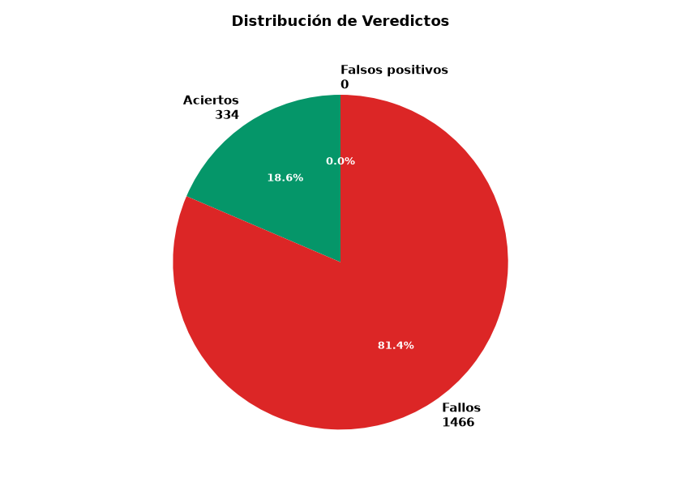
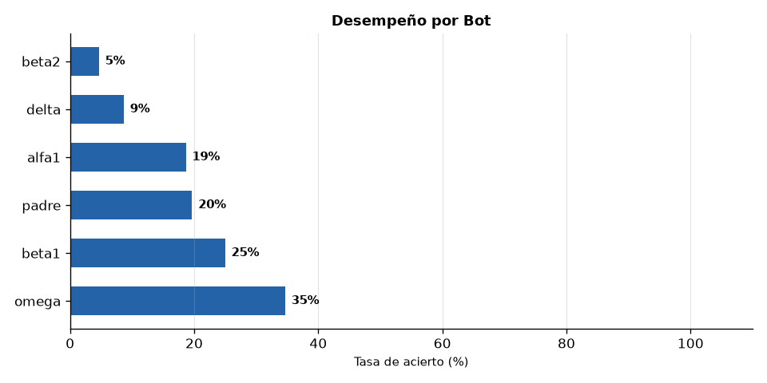

# 🔄 Comparativo diario — 2026-10-21 vs 2026-10-20
*Corte 01:23 hora MX*

| Métrica | Hoy | Ayer | Cambio |
|---|---:|---:|---:|
| Fantasma medio | 8.5 | 11.1 | ▼ -2.6 |
| Fantasma máx | 9.2 | 14.6 | ▼ -5.4 |
| Ciclos corridos | 2 | 8 | ▼ -6 |
| Breaches del Muro | 0 | 0 | ＝ +0 |
| Asertividad viva (resuelta en el día) | — | — | — |
| Patrones cimáticos (total / nuevos 24h) | 2365 | — | +20 |

## ✅ Aciertos — Últimas 24 horas

| Métrica | Valor |
|---------|-------|
| **Aciertos** | 334 |
| **Fallos** | 1466 |
| **Falsos positivos** | 0 |
| **Tasa de acierto** | 18.6% `▓▓░░░░░░░░░░` |
| **Total predicciones** | 1800 |

### 🤖 Desempeño por Bot

| Bot | Aciertos | Tasa | Confianza | Ventana declarada |
|-----|----------|------|-----------|--------------------|
| omega | 104/300 | 35% `▓▓▓░░░░░` | 0.35 | 0.0h |
| beta1 | 75/300 | 25% `▓▓░░░░░░` | 0.25 | 0.0h |
| padre | 59/300 | 20% `▓▓░░░░░░` | 0.20 | 0.0h |
| alfa1 | 56/300 | 19% `▓░░░░░░░` | 0.19 | 0.0h |
| delta | 26/300 | 9% `▓░░░░░░░` | 0.09 | 0.0h |
| beta2 | 14/300 | 5% `░░░░░░░░` | 0.05 | 0.0h |

