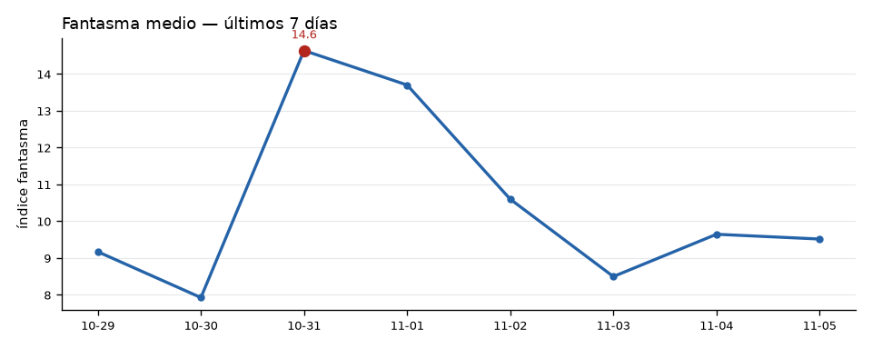

# 🔄 Comparativo diario — 2026-11-08 vs 2026-11-07
*Corte 12:45 hora MX*

| Métrica | Hoy | Ayer | Cambio |
|---|---:|---:|---:|
| Fantasma medio | 15.4 | 11.7 | ▲ +3.7 |
| Fantasma máx | 15.6 | 14.1 | ▲ +1.4 |
| Ciclos corridos | 3 | 5 | ▼ -2 |
| Breaches del Muro | 0 | 0 | ＝ +0 |
| Asertividad viva (resuelta en el día) | — | — | — |
| Patrones cimáticos (total / nuevos 24h) | 2624 | — | +12 |

## ✅ Aciertos — Últimas 24 horas

**No hay predicciones auditadas en este período.**

