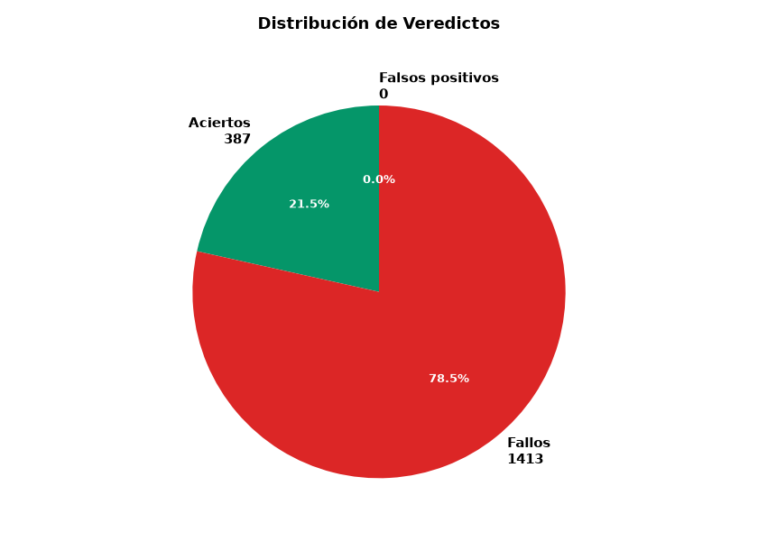
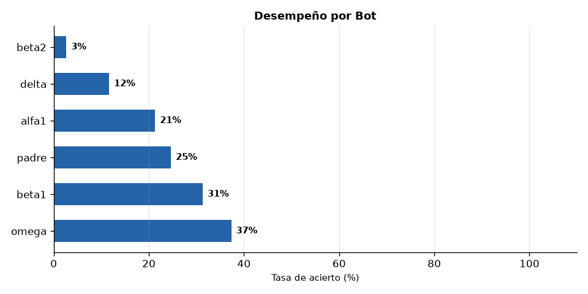

# 🔄 Comparativo diario — 2026-11-22 vs 2026-11-21
*Corte 00:04 hora MX*

| Métrica | Hoy | Ayer | Cambio |
|---|---:|---:|---:|
| Fantasma medio | 7.6 | 8.3 | ▼ -0.7 |
| Fantasma máx | 7.6 | 8.5 | ▼ -0.9 |
| Ciclos corridos | 1 | 4 | ▼ -3 |
| Breaches del Muro | 1 | 3 | ▼ -2 |
| Asertividad viva (resuelta en el día) | — | — | — |
| Patrones cimáticos (total / nuevos 24h) | 2772 | — | +12 |

## ✅ Aciertos — Últimas 24 horas

| Métrica | Valor |
|---------|-------|
| **Aciertos** | 387 |
| **Fallos** | 1413 |
| **Falsos positivos** | 0 |
| **Tasa de acierto** | 21.5% `▓▓▓░░░░░░░░░` |
| **Total predicciones** | 1800 |

### 🤖 Desempeño por Bot

| Bot | Aciertos | Tasa | Confianza | Ventana declarada |
|-----|----------|------|-----------|--------------------|
| omega | 112/300 | 37% `▓▓▓░░░░░` | 0.37 | 0.0h |
| beta1 | 94/300 | 31% `▓▓▓░░░░░` | 0.31 | 0.0h |
| padre | 74/300 | 25% `▓▓░░░░░░` | 0.25 | 0.0h |
| alfa1 | 64/300 | 21% `▓▓░░░░░░` | 0.21 | 0.0h |
| delta | 35/300 | 12% `▓░░░░░░░` | 0.12 | 0.0h |
| beta2 | 8/300 | 3% `░░░░░░░░` | 0.03 | 0.0h |

