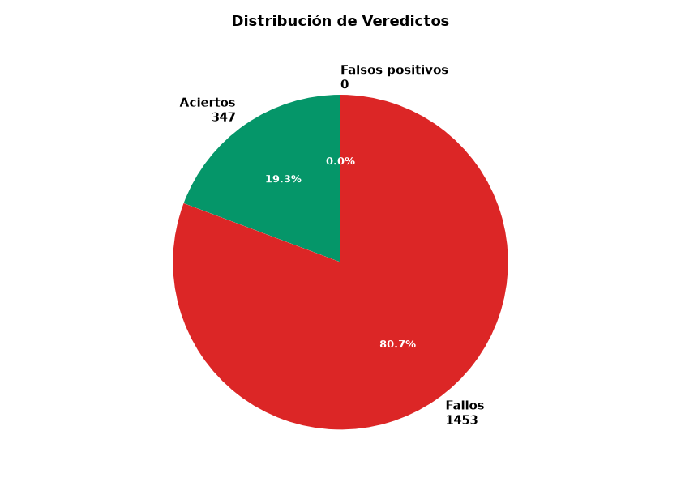
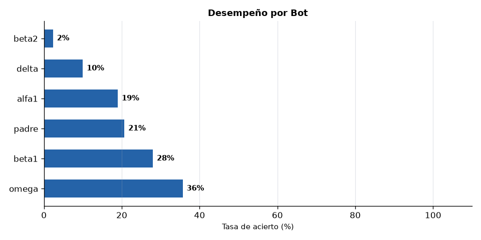

# 🔄 Comparativo diario — 2026-11-05 vs 2026-11-04
*Corte 00:03 hora MX*

| Métrica | Hoy | Ayer | Cambio |
|---|---:|---:|---:|
| Fantasma medio | 9.5 | 9.6 | ▼ -0.1 |
| Fantasma máx | 9.5 | 10.4 | ▼ -0.9 |
| Ciclos corridos | 1 | 4 | ▼ -3 |
| Breaches del Muro | 0 | 0 | ＝ +0 |
| Asertividad viva (resuelta en el día) | — | — | — |
| Patrones cimáticos (total / nuevos 24h) | 2581 | — | +14 |

## ✅ Aciertos — Últimas 24 horas

| Métrica | Valor |
|---------|-------|
| **Aciertos** | 347 |
| **Fallos** | 1453 |
| **Falsos positivos** | 0 |
| **Tasa de acierto** | 19.3% `▓▓░░░░░░░░░░` |
| **Total predicciones** | 1800 |

### 🤖 Desempeño por Bot

| Bot | Aciertos | Tasa | Confianza | Ventana declarada |
|-----|----------|------|-----------|--------------------|
| omega | 107/300 | 36% `▓▓▓░░░░░` | 0.36 | 0.0h |
| beta1 | 84/300 | 28% `▓▓░░░░░░` | 0.28 | 0.0h |
| padre | 62/300 | 21% `▓▓░░░░░░` | 0.21 | 0.0h |
| alfa1 | 57/300 | 19% `▓▓░░░░░░` | 0.19 | 0.0h |
| delta | 30/300 | 10% `▓░░░░░░░` | 0.10 | 0.0h |
| beta2 | 7/300 | 2% `░░░░░░░░` | 0.02 | 0.0h |

