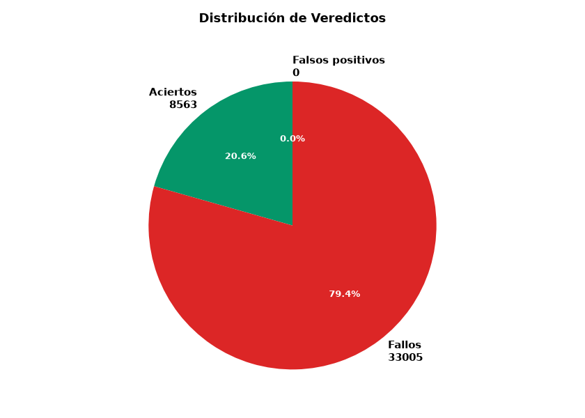
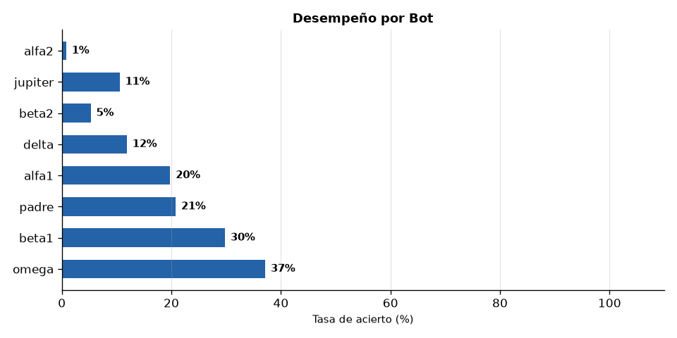
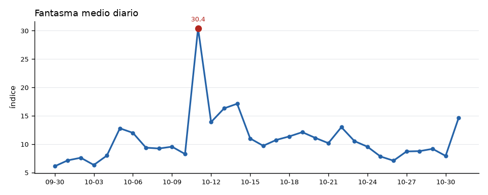
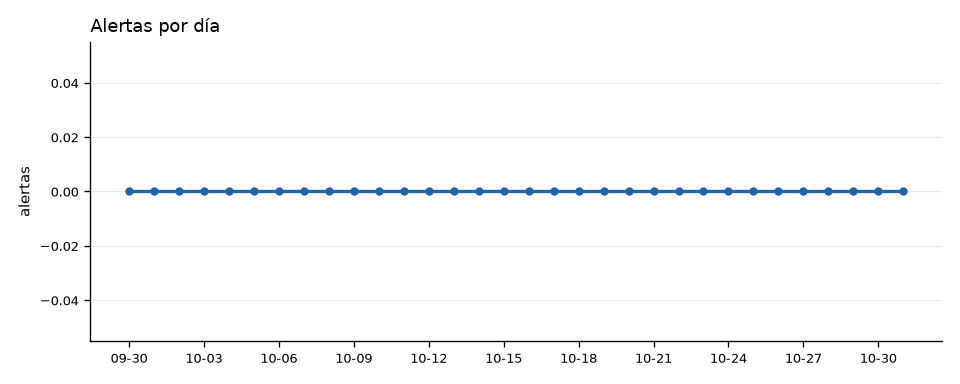
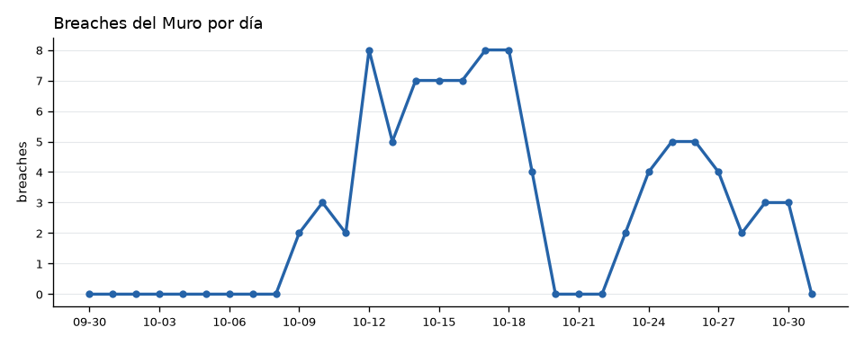

# 🗓️ Reporte mensual — Sentinel Omega
*Generado 2026-10-01 00:04 hora MX — ventana 31 días*

> **Lectura rápida:** el sistema estuvo **inquieto** · Fantasma medio **11.6** (MODERATE · atención) · Muro con **70 breach(es)** · asertividad viva **86%**.

## Resumen
- Ciclos corridos: **5900**
- Fantasma medio del periodo: **11.6**
- Fantasma máximo: **62.2**
- Breaches del Muro: **70**
- Asertividad viva del periodo: **86%** (n=31360 resueltas)

## Cimática
- Patrones `general`: 131245 (frecuencia máx 98)
- Patrones `nodo`: 165811 (frecuencia máx 169)

| Patrón | Ámbito | Evento asociado | Frecuencia |
|---|---|---|---:|
| 2022633 | nodo 96 | SISMO_M5 | 169 |
| 2022631 | general | SISMO_M4 | 98 |
| 1804048 | general | SISMO_M4 | 94 |
| 1804049 | nodo 109 | SISMO_M4 | 94 |
| 2022632 | nodo 97 | SISMO_M4 | 90 |
| 2022629 | nodo 96 | SISMO_M5 | 76 |
| 2022693 | general | SISMO_M4 | 76 |
| 2022694 | nodo 28 | SISMO_M4 | 76 |
| 2022642 | nodo 96 | SISMO_M5 | 74 |
| 2022696 | nodo 110 | SISMO_M5 | 74 |

## ✅ Aciertos — Últimos 31 días

| Métrica | Valor |
|---------|-------|
| **Aciertos** | 27120 |
| **Fallos** | 1168 |
| **Falsos positivos** | 3072 |
| **Tasa de acierto** | 86.4% `▓▓▓▓▓▓▓▓▓▓░░` |
| **Total predicciones** | 31392 |

### 🤖 Desempeño por Bot

| Bot | Aciertos | Tasa | Confianza | Anticipación |
|-----|----------|------|-----------|---------------|
| alfa2 | 3336/3481 | 96% `▓▓▓▓▓▓▓▓` | 0.11 | 0.1d |
| beta2 | 3282/3481 | 94% `▓▓▓▓▓▓▓▓` | 0.21 | 0.1d |
| loki | 3272/3481 | 94% `▓▓▓▓▓▓▓▓` | 0.30 | 0.1d |
| omega | 3131/3481 | 90% `▓▓▓▓▓▓▓░` | 0.40 | 0.1d |
| jupiter | 3047/3481 | 88% `▓▓▓▓▓▓▓░` | 0.26 | 0.1d |
| padre | 2899/3512 | 83% `▓▓▓▓▓▓▓░` | 0.17 | 0.1d |
| delta | 2879/3481 | 83% `▓▓▓▓▓▓▓░` | 0.39 | 0.1d |
| beta1 | 2801/3481 | 80% `▓▓▓▓▓▓░░` | 0.40 | 0.1d |
| alfa1 | 2473/3481 | 71% `▓▓▓▓▓▓░░` | 0.42 | 0.1d |

## ℹ️ Cómo leer este reporte

- **Fantasma** — índice de *riesgo cósmico* (TITAN V32). **No es un sismo**: mide la
  tensión del sistema combinando campo magnético (Bz), viento solar, resonancia
  Schumann, presión y más. Escala: **LOW <5** (calma) · **MODERATE 5–15** (atención)
  · **HIGH 15–30** (avisar) · **CRITICAL ≥30** (protocolo).
- **Muro de los 5 Eventos** — cinco "paredes" de correlación (geofísica, atmosférica,
  oceánica, solar/geomagnética y financiera). Hay *breach* cuando **3 o más** se
  activan a la vez.
- **Asertividad viva** — de las predicciones ya verificadas contra la realidad (USGS),
  qué porcentaje resultó **ACIERTO**. Verdad por fila, ventana de 72 h; el Juez
  audita aparte (nunca predice).
- **Cimática** — patrones de telemetría que el sistema ve repetirse; si un patrón
  antecede a un evento real se etiqueta con su clase (SISMO_M4…M7, ERUPCION_VEI…).
  La frecuencia es cuántas veces se ha visto ese patrón.
- **Anticipación** — días de adelanto promedio entre la señal y el evento.
