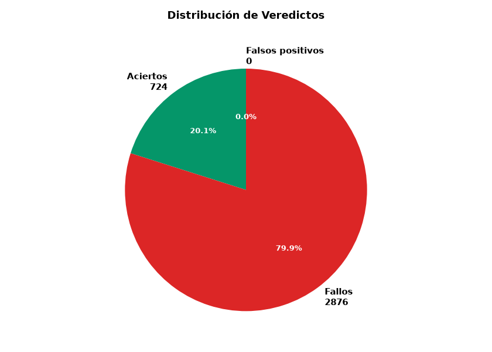
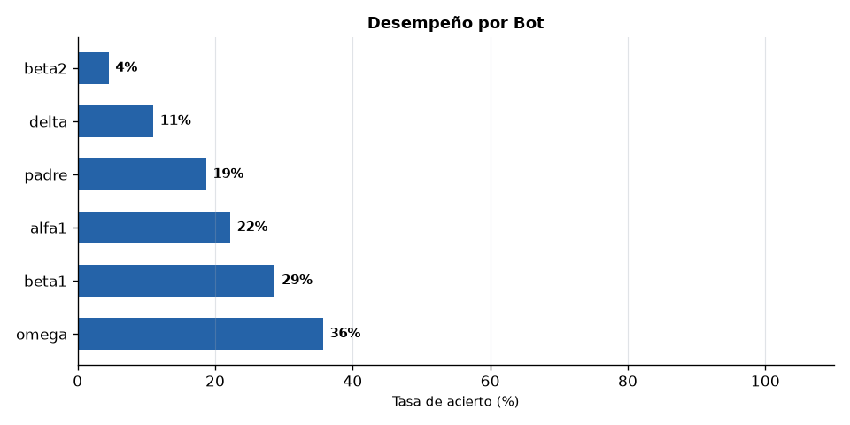
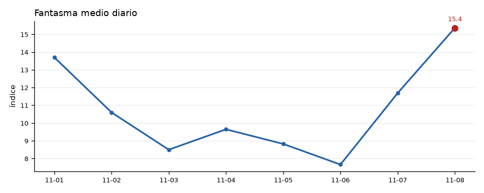
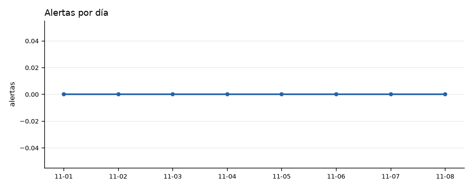
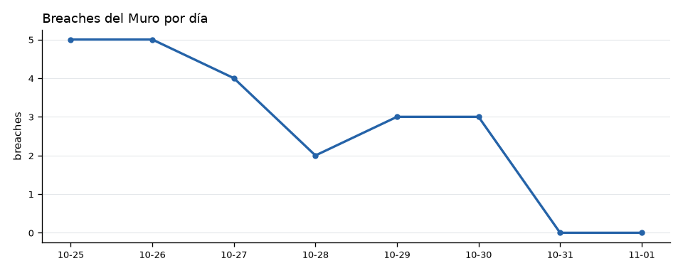

# 📅 Reporte semanal — Sentinel Omega
*Generado 2026-11-08 16:06 hora MX — ventana 7 días*

## Resumen
- Ciclos corridos: **28**
- Fantasma medio del periodo: **10.7**
- Fantasma máximo: **15.6**
- Breaches del Muro: **0**
- Asertividad viva del periodo: **—** (n=0 resueltas)

## Cimática
- Patrones `general`: 671 (frecuencia máx 10)
- Patrones `nodo`: 1953 (frecuencia máx 15)

| Patrón | Ámbito | Evento asociado | Frecuencia |
|---|---|---|---:|
| 1562 | nodo 35 | SISMO_M5 | 15 |
| 163 | nodo 14 | SISMO_M6 | 12 |
| 313 | nodo 14 | SISMO_M6 | 11 |
| 800 | general | SISMO_M5 | 10 |
| 1568 | nodo 35 | SISMO_M5 | 10 |
| 801 | nodo 48 | SISMO_M5 | 9 |
| 1652 | nodo 14 | SISMO_M5 | 9 |
| 451 | general | SISMO_M6 | 8 |
| 452 | nodo 35 | SISMO_M6 | 8 |
| 456 | nodo 14 | SISMO_M6 | 8 |

## ✅ Aciertos — Últimos 7 días

| Métrica | Valor |
|---------|-------|
| **Aciertos** | 694 |
| **Fallos** | 2906 |
| **Falsos positivos** | 0 |
| **Tasa de acierto** | 19.3% `▓▓░░░░░░░░░░` |
| **Total predicciones** | 3600 |

### 🤖 Desempeño por Bot

| Bot | Aciertos | Tasa | Confianza | Ventana declarada |
|-----|----------|------|-----------|--------------------|
| omega | 214/600 | 36% `▓▓▓░░░░░` | 0.36 | 0.0h |
| beta1 | 168/600 | 28% `▓▓░░░░░░` | 0.28 | 0.0h |
| padre | 124/600 | 21% `▓▓░░░░░░` | 0.21 | 0.0h |
| alfa1 | 114/600 | 19% `▓▓░░░░░░` | 0.19 | 0.0h |
| delta | 60/600 | 10% `▓░░░░░░░` | 0.10 | 0.0h |
| beta2 | 14/600 | 2% `░░░░░░░░` | 0.02 | 0.0h |

